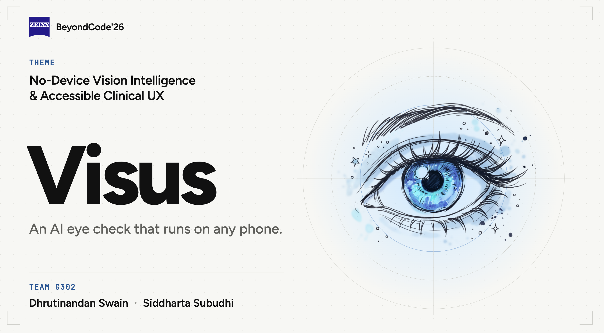
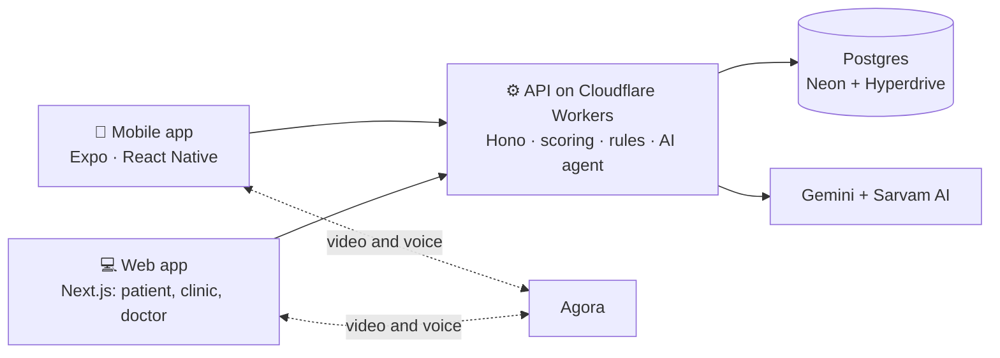

<p align="center">
  
</p>

<h1 align="center">Visus</h1>

<p align="center">
  <b>An AI eye check on any phone, and an eye doctor on a video call when it's needed.</b><br>
  ZEISS BeyondCode'26 · <i>No-Device Vision Intelligence & Accessible Clinical UX</i> · Team G302: Dhrutinandan Swain and Sidhartha Subudhi
</p>

<p align="center">
  <a href="https://visus-eye-screening-app.vercel.app"><b>Open the web app</b></a> ·
  <a href="https://expo.dev/artifacts/eas/wQgq-J_bnLmTDAaEbrhoAYT9W1bqj1kq0rdXuTjo9jM.apk"><b>Android APK</b></a> ·
  <a href="https://visus-api.dhrutinandan-dev-80e.workers.dev/health">API health</a>
</p>

> **Screening, not diagnosis.** Visus tells you when to see an eye doctor; it does not replace one.

## How it works

1. **Tell Visus what's wrong**, typing or talking, in English, Hindi or Odia.
2. **An AI agent picks the vision tests** and re-plans after every result. Red flags come from clinical rules, never from the AI alone.
3. **Take the tests on your phone**, at real sizes thanks to screen calibration and camera distance.
4. **Get plain-language results** with a ZEISS lens suggestion, or a "see an eye doctor" flag.
5. **See a doctor remotely:** a clinic books a video consult with live translated captions, tests the doctor sends to your screen, and a prescription in your language.

## Features

| | |
|---|---|
| 🧠 **AI eye check** | A short intake chat, then an adaptive test plan from 14 tests: acuity, near reading, astigmatism, red-green, Amsler grid, contrast, peripheral vision, colour plates, questionnaires and two kids' tests. Full, 1-minute, glasses and single-test modes. |
| 🗣️ **Voice, 3 languages** | Talk mode in English, Hindi and Odia with a natural Indian voice (Sarvam AI); instructions and results read aloud. |
| 📏 **Clinical sizes, no device** | Bank-card screen calibration (pixels per mm) and front-camera distance that pauses the test when you move. |
| 🚩 **Rules first, AI second** | Red flags (Amsler distortion, field loss, very low acuity, urgent words) come from rules; Gemini plans and explains, with Sarvam as a backup. |
| 📊 **Results** | Score per area and per eye, plain meaning, trends, ZEISS lens and coating suggestions; share as PDF, WhatsApp or a QR link. |
| 👨‍👩‍👧 **Family & habits** | Family profiles with saved glasses; Screen Coach (Android) with real screen time and 20-20-20 breaks. |
| 🏪 **Clinic portal** (web) | Walk-in patient records, any check on the counter's screen, consent-based linking of a patient's own account, glasses orders. |
| 🩺 **Remote consult** | Clinics add doctors by Visus ID and book 15-minute slots. Video and voice over Agora, captions translated live, live tests pushed by the doctor, an AI summary of the patient's history (labelled as such), a prescription translated for the patient, automatic follow-up booking and calendar reminders. |
| ♿ **Accessible** | Adjustable text size, large touch targets, clinical white test screens, simple wording, guest mode without an account. |

## Try it

The web app opens on the landing page. These demo accounts are already linked, so the clinic can book a consult straight away:

| Who | Where | Login | Password |
|---|---|---|---|
| Patient | Android app (APK above) | `9000012345` | `visus1234` |
| Clinic | [web → `/shop/login`](https://visus-eye-screening-app.vercel.app/shop/login) | `clinic@visus.demo` | `visus1234` |
| Doctor | [web → `/doctor/login`](https://visus-eye-screening-app.vercel.app/doctor/login) | `doctor@visus.demo` | `visus1234` |

Consult demo: the clinic books the next free slot → the doctor and the patient join → turn on captions → the doctor sends a test → the doctor saves the prescription.

## Inside



All the logic lives on the server; the apps show screens and collect raw answers. Every device in a consult polls one small `/live` route for captions, tests and the prescription.

| Part | Stack | Read more |
|---|---|---|
| **Mobile** | Expo SDK 57, Expo Router, Skia, VisionCamera + ML Kit, speech recognition, Agora, a Kotlin module (Screen Coach), EAS | [apps/mobile](apps/mobile/README.md) |
| **Web** | Next.js (App Router), Tailwind CSS, MediaPipe, Agora web SDK, Vercel | [apps/web](apps/web/README.md) |
| **Server** | Hono on Cloudflare Workers, Drizzle + Postgres (Neon, Hyperdrive), zod, JWT, Gemini, Sarvam AI, Agora tokens | [apps/server](apps/server/README.md) |
| **Shared** | zod schemas, types and the test catalog used by all three | `packages/shared` |

Docs: [Setup](docs/SETUP.md) · [Architecture](docs/ARCHITECTURE.md) · [API](docs/API.md) · [Remote consult](docs/CONSULT.md)

## Run it locally

```bash
bun install                                # repo root (Bun only)
cd apps/server && bun run dev:phone        # API on :8787
cd apps/web && bun dev                     # web on :3000
cd apps/mobile && bunx expo start -c       # Metro; open it in the Visus development build
```

Secrets, the database and phone setup: [docs/SETUP.md](docs/SETUP.md).
