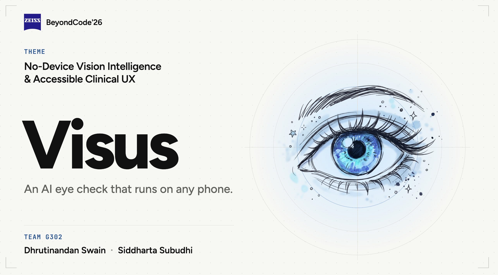

<p align="center">
  
</p>

# Visus

**An AI eye check that runs on any phone.** Built for ZEISS BeyondCode'26 (theme: *No-Device Vision Intelligence & Accessible Clinical UX*) by Team G302: Dhrutinandan Swain and Siddharta Subudhi.

You describe your eye problem in a short chat. An AI agent then picks the right vision tests, and you take them on your phone. After each test the agent re-plans. The check ends with plain-language results, a "see a doctor" flag when the rules call for one, and a ZEISS lens suggestion.

> **Screening, not diagnosis.** Visus tells you when to see an eye doctor; it does not replace one.

## Features

- **AI intake chat:** Gemini asks up to 3 short follow-up questions, with quick-reply chips. You can type or speak (voice input).
- **Adaptive test plan:** the AI picks tests only from the test catalog and adds up to 2 tests after a result that needs a closer look. Rules handle the fixed cases.
- **14 vision tests:**
  - Distance acuity (Tumbling E) and near reading
  - Near point, astigmatism dial and red-green test
  - Amsler grid, contrast sensitivity and peripheral vision
  - Colour vision plates
  - Questionnaires for eye risk, eye strain, and glare and night vision
  - Two kids tests (Tumbling E and colour shapes)
- **Real sizes:** screen calibration with a bank card gives pixels per mm. Test symbols are drawn at clinical sizes.
- **Camera distance** (installed app): the front camera measures your face distance. It guides you to the test distance and pauses the test if you move too close or too far.
- **Red flags from rules, not AI:**
  - distortion on the Amsler grid, a peripheral field loss or very low acuity;
  - urgent words in the chat, such as sudden vision loss or flashes.
  When a rule fires, the app shows a "see an eye doctor" screen.
- **Check modes:**
  - full AI check;
  - 1-minute quick check;
  - glasses check (without vs. with glasses);
  - any single test from the Tests library;
  - a kids flow.
- **Results:** a score per area and per eye, plain-language meaning, a trend over past checks, and ZEISS lens and coating suggestions.
- **Share:** PDF report, WhatsApp, or a 24-hour link with a QR code that opens the report on the web.
- **Family profiles:** add family members (child mode included) and save their glasses prescriptions.
- **Screen Coach** (Android, installed app):
  - real screen time from the phone's usage stats, with a weekly view;
  - 20-20-20 break reminders shown over other apps;
  - a daily goal (2 h in child mode).
- **Guest mode:** take any single test without an account. Results are scored but not saved.
- **Accessible:** adjustable text size, large touch targets, clinical white test screens, and simple wording.

## Tech

| Part | Stack |
|---|---|
| Mobile (`apps/mobile`) | Expo SDK 57, Expo Router, React Native, Skia, VisionCamera v5 + ML Kit face detection, `expo-speech-recognition`, local Kotlin module (Screen Coach), zustand, TanStack Query, EAS Build |
| Web (`apps/web`) | Next.js (App Router), Tailwind CSS, MediaPipe (camera distance), zustand, TanStack Query, Vercel |
| Server (`apps/server`) | Hono on Cloudflare Workers, Drizzle ORM + `pg`, Postgres on Aiven (Hyperdrive in production), zod, JWT + PBKDF2, Gemini API |
| Shared (`packages/shared`) | zod schemas, types and the test catalog used by all three |
| Tooling | Bun workspaces (Bun only), TypeScript everywhere |

## Repo

| Folder | What |
|---|---|
| [`apps/mobile`](apps/mobile/README.md) | Android app (Expo) |
| [`apps/web`](apps/web/README.md) | Web app (Next.js) |
| [`apps/server`](apps/server/README.md) | API, AI agent, scoring, rules and lens logic |
| `packages/shared` | Shared types and test catalog |
| `docs/` | [Setup](docs/SETUP.md), [Architecture](docs/ARCHITECTURE.md), [API](docs/API.md), [Screens](docs/SCREENS.md) |
| `design/` | Claude Design handoff |

## Get started

**[docs/SETUP.md](docs/SETUP.md)** walks through the whole setup:
- installing dependencies;
- secrets and the database;
- running the server, web and mobile together on one network;
- the EAS build for the phone;
- deployment.

**[docs/ARCHITECTURE.md](docs/ARCHITECTURE.md)** explains how a check flows through the apps, the server, the rules and the AI.

Quick version (Bun required):

```bash
bun install                                # repo root
cd apps/server && bun run dev:phone        # API on :8787
cd apps/web && bun dev                     # web on :3000
cd apps/mobile && bunx expo start -c       # Metro; open in the Visus dev build
```

Contributors: read [`CLAUDE.md`](CLAUDE.md) (rules), [`WORK.md`](WORK.md) (tasks) and `progress/` (status per person).
