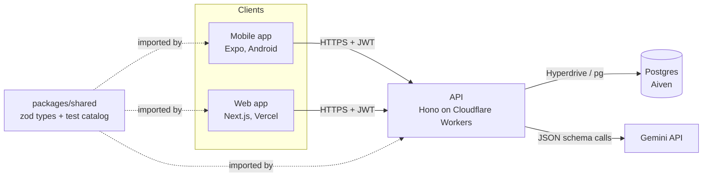
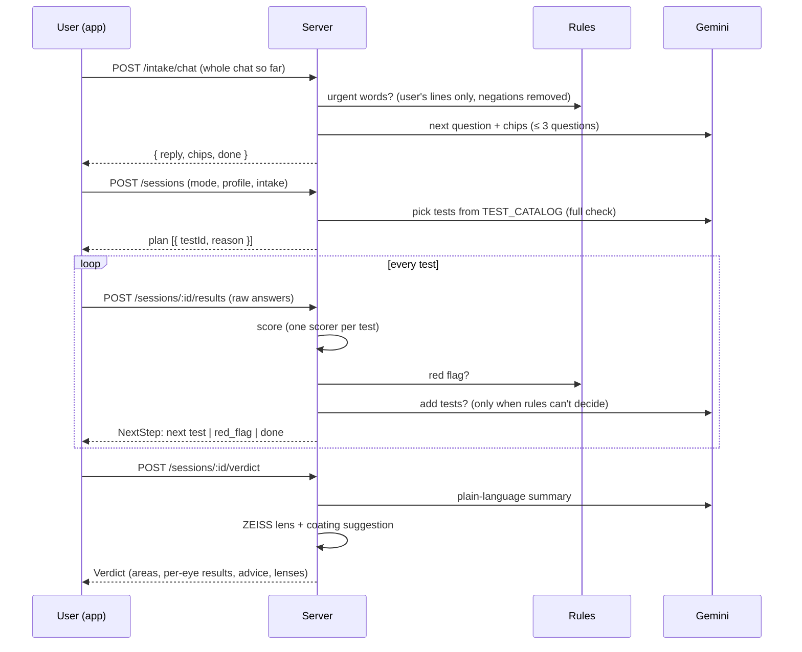
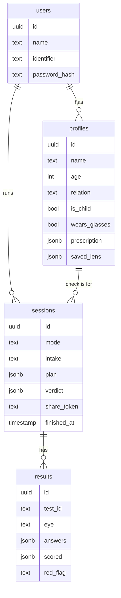

# Architecture

Visus has two thin clients (mobile and web) and one server that owns all the logic. The clients draw screens and tests and collect **raw answers**. The server scores them, runs the rules, asks the AI, and suggests lenses.

## System



- **One contract:** every request and response is a zod schema in `packages/shared`. All three apps import it, so a shape change breaks the typecheck instead of failing at runtime.
- **Thin clients:** screens call `services/*` and never `fetch` directly. `USE_MOCK` swaps every service to local mock data, so the UI works without a server.
- **Local and production run the same app:**
  - Locally, `src/local.ts` runs the Hono app on Bun (`0.0.0.0:8787`) for the phone.
  - In production it runs on Workers, with Hyperdrive pooling the Postgres connection.

## How a check flows



### Check modes

`POST /sessions` takes one of these modes:

| Mode | Plan |
|---|---|
| `full` | The AI plans from the intake chat. Kids profiles get the kids tests. |
| `quick` | Tumbling E → Amsler → Clock dial (about 1 minute) |
| `glasses` | Tumbling E twice: without glasses, then with them |
| `single` | One test from the library |

Guest mode skips sessions entirely: `POST /reports/guest-score` uses the same scorer and red-flag rules but saves nothing.

## Rules first, AI second

| Decision | Who makes it |
|---|---|
| Scores | Server scorers (`features/scoring`), deterministic |
| Red flags (see a doctor) | Rules only (`features/rules`). Examples: distortion on the Amsler grid, a peripheral eye score ≤ 67, acuity below 20/200, contrast score 0, urgent words in the chat |
| Fixed plans (quick, glasses, single, kids) | Rules |
| Full-check plan, extra tests, verdict wording | Gemini, validated against a zod JSON schema |
| Lens suggestion | Rules over the ZEISS catalog (`features/lens`) |

Gemini can only pick test IDs from `TEST_CATALOG`. If it's slow, down or returns invalid JSON, every AI step has a rule-based fallback, so a check never blocks on the AI.

How the Gemini calls are raced (`src/lib/gemini.ts`):
1. The server asks Flash-Lite first.
2. After 2.5 s with no answer, it also asks the next model.
3. The first valid answer wins, and the others are cancelled.
4. After 7 s it uses the rule fallback.
5. Models that answer 429 or 503 are skipped for 60 s.

## Server layout

The code is organised feature first; each folder holds its own routes, logic and queries.

```
apps/server/src/
  index.ts        CORS, per-request DB, error handler, route mounts
  local.ts        same app on Bun for local phone testing
  db/             Drizzle schema + connection (Hyperdrive or direct)
  lib/            env, errors, validation, Gemini client, transcript helpers
  features/
    auth/         signup, login, /me, PBKDF2 + pepper, JWT (30 days)
    profiles/     self + family profiles, glasses prescription
    intake/       POST /intake/chat
    agent/        Gemini prompts: intake, plan, re-plan, verdict (+ fallbacks)
    sessions/     create session, submit result, verdict: ties it all together
    scoring/      14 scorers: raw answers → score, status, per-eye result
    rules/        red flags + rule plans
    lens/         ZEISS lens and coating catalog + recommendation
    history/      past checks, share links (24 h), guest scoring
```

## Data model



## Clients

| | Mobile (`apps/mobile`) | Web (`apps/web`) |
|---|---|---|
| Routing | Expo Router (`src/app`) | Next.js App Router (`app/`) |
| Tests | Skia drawings, sized from calibration (px per mm) | SVG / Canvas, sized the same way |
| Camera distance | VisionCamera v5 + ML Kit face detection (pinhole model: eye spacing → cm) | MediaPipe face landmarks |
| Voice input | `expo-speech-recognition` | Web Speech API |
| Token | `expo-secure-store` | `localStorage` |
| Mobile only | Screen Coach: a local Kotlin module that reads usage stats and runs a foreground service with a break overlay | none |

The two clients share the same screens and routes (see [SCREENS.md](SCREENS.md)). Native features load lazily, so the mobile app still runs in Expo Go without them.

## Security and privacy

- Passwords are hashed with PBKDF2 (100k iterations) plus a server-side pepper. Sessions use HS256 JWTs.
- Secrets live only in `apps/server/.dev.vars` (local) and `wrangler secret` (production). The apps hold no keys.
- The camera frames used for distance are processed on the device and never sent. Answers and results are stored on the server for the user's history. Share links expire after 24 h.
