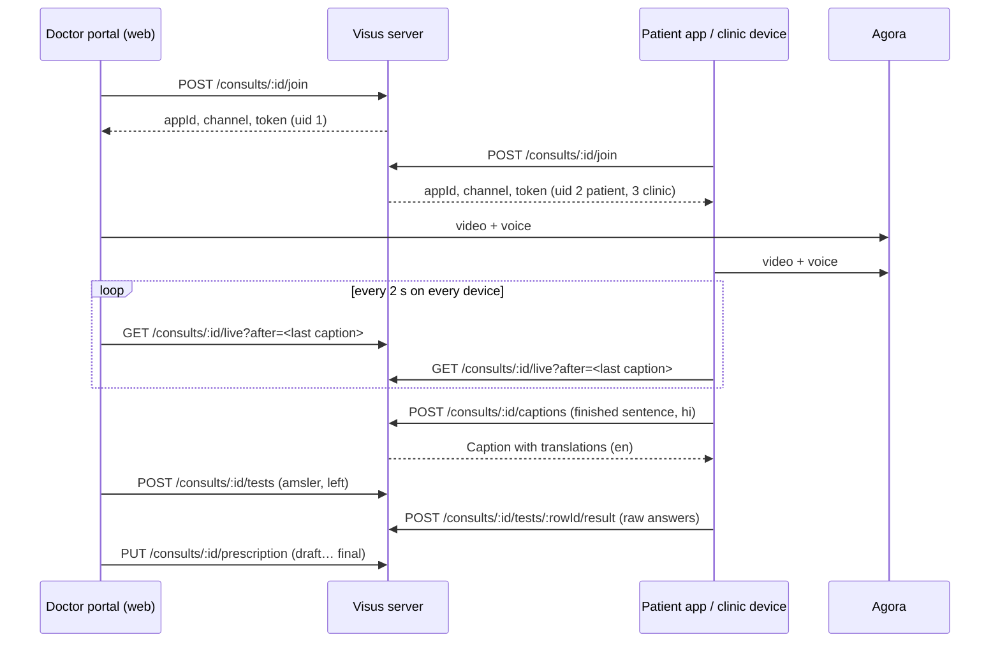

# Remote consult (final submission)

A rural clinic connects its patient to an eye doctor anywhere, by video, with **live captions in each side's language**. During the call the doctor **pushes Visus tests** to the patient's screen and sees the results at once, then writes a **prescription** that lands in the patient's, the clinic's and the doctor's records.

Screening, not diagnosis: the Visus tests and the AI summary help the doctor; the doctor decides. Visus never suggests medicines.

Types: `packages/shared/src/index.ts` → "Remote consult". Routes: [API.md](API.md) → Remote consult. Screens: [SCREENS.md](SCREENS.md) → Remote consult. Tasks: [`WORK.md`](../WORK.md) → Final submission.

## Who does what

| Role | Where | What they do |
|---|---|---|
| **Clinic** | Shop portal (web, `/shop`; "shop" is the code name, the UI can say clinic) | Adds doctors by Visus ID; books consults for **linked** patients (the only one who books); joins the call from the clinic's device when the patient sits there; sees consults and prescriptions on the patient's page |
| **Doctor** | Doctor portal (web, `/doctor`, new) | Signs up (gets a Visus ID); approves clinic requests; sets weekly hours per clinic; sees today's and upcoming consults; opens the patient file (AI summary first); runs the call; pushes tests; writes the prescription; keeps their records |
| **Patient** | Visus app (Android) and web | Sees the consults booked for them (no booking screen); adds them to the calendar; joins from home; takes the tests the doctor sends; sees prescriptions in their records |

## The flow

1. **Doctor signs up** at `/doctor/register`: name, login, password, specialty, registration number (taken as typed, not verified, for the demo), languages. They get a **Visus ID** like `VIS-D-7K3Q` (letters and digits without 0, O, 1, I).
2. **Clinic adds the doctor:** Doctors tab → types the Visus ID → the link is `pending` and the doctor sees a request.
3. **Doctor approves** and sets **weekly hours** for that clinic (e.g. Mon and Wed 16:00–18:00, India time). One doctor can work for several clinics. The clinic can remove a doctor; the doctor can leave a clinic.
4. **Clinic books a consult:** picks a linked patient → an active doctor → a date → a free 15-minute slot → "from home" or "at the clinic" → reason and the patient's language. Booking shares the patient's records with that doctor (the screen says so).
5. **Reminders:**
   - Patient app (phone): the event goes straight into the phone's calendar with alarms 1 h and 10 min before (`expo-calendar`).
   - Web (doctor, clinic, patient): "Add to Google Calendar" link and an `.ics` download (same alarms).
   - Every app: a **"Join now"** banner from 10 minutes before the start to the end.
6. **Before the call:** the doctor opens the patient file: the **AI summary first** ("AI summary, check the full records"), then the full history: checks, results, glasses, earlier prescriptions and consults.
7. **The call** (Agora): video and voice, with an audio-only switch for a weak network. The patient joins from their app, or the clinic joins from its device with the patient there. **Live captions** in each side's language; the transcript is saved.
8. **Live tests:** the doctor picks a test and an eye. The test opens full screen on the patient's device (video goes small). The patient answers, the server scores it, and the result card appears on the doctor's screen. On a laptop that hasn't been calibrated, the screen-size setup runs first.
9. **Prescription** (side panel during the call, autosaved as a draft): first consult or follow-up, symptoms, observations, glasses power (optional), medicines (name, dose, how often, days), remedies and daily practices, follow-up date. The doctor's name and registration number are printed on it.
10. **Save and end:** the prescription is final. It is translated into the patient's language (medicine names stay as written) and shows up in the patient's records, on the clinic's patient page and in the doctor's records. A follow-up date **books the next consult automatically** (the doctor's first free slot that day at the same clinic) and sends new calendar events; the clinic can move it.

Consult status: `scheduled` → `live` (first join) → `completed` (prescription saved or the doctor ends it). `cancelled` by the clinic. `missed` when nobody joined by 15 minutes after the start (worked out when the consult is read, no cron job).

## How the call works



- **Agora carries only video and voice.** Everything else (captions, live tests, prescription state) goes through our server, and every device polls `GET /consults/:id/live` every 2 s during a call. One path that works the same on web and Android, and nothing is lost if a message drops.
- **Agora free tier:** 10,000 minutes a month. A 15-minute consult with 2 people uses about 30.
- **SDKs:** web (doctor portal, clinic portal, patient web) `agora-rtc-sdk-ng`; Android `react-native-agora` (needs an EAS development build, not Expo Go).
- **Channel** = the consult id. **uid:** doctor 1, patient 2, clinic 3.
- **Token:** made by the server with the App ID and App Certificate (`AGORA_APP_ID`, `AGORA_APP_CERTIFICATE`, server secrets only), valid 2 hours, given only to the consult's doctor, patient or clinic. If the token library won't run on Workers, the demo uses an Agora project in **testing mode** (App ID only, `token: null`).

## Live captions and translation

1. **Each device captions its own person's speech** with the device's speech recognition (web: the browser's `SpeechRecognition`; Android: `expo-speech-recognition`, already in the app), in that person's language (`SPEECH_LOCALE`).
2. While they talk, the partial words show only on their own screen ("You: …").
3. Each **finished sentence** (max 300 characters) goes to `POST /consults/:id/captions` with its language.
4. The server translates it into the other people's languages and saves it. Doctor's language = the first of `doctor.languages`; patient's and clinic's = the consult's `language`.
5. The other devices get it from `/live` and show `translations[myLanguage] ?? text`, with the speaker's name.
6. The transcript (all captions) is kept on the consult and shown to the doctor afterwards.

**Translation** (`apps/server/src/lib/translate.ts`): Gemini Flash-Lite through the key pool first; Sarvam's `sarvam-105b-conversations` joins the hedge when Gemini is slow or busy (`lib/gemini.ts`); if both fail, the caption is saved untranslated and shown as it is. Medicine names, doses and eye powers are kept as written.

**Two risks to check on day 1** (D, see `WORK.md`):
- Android may not let `expo-speech-recognition` use the mic while Agora is in a call. Fallback: the doctor portal records the patient's incoming audio track in 5-second pieces (`MediaRecorder`) and sends them to `POST /voice/stt` (Sarvam), so the patient's captions are made on the doctor's side.
- The browser or phone may not recognise Odia (`or-IN`). Same fallback: 5-second pieces to `/voice/stt`.

## Live tests

1. Doctor: `POST /consults/:id/tests` `{ testId, eye }`. The server makes a `consult_tests` row and a normal check session (`mode: "single"`) for the patient's profile (`shop_id` = the clinic), so the existing scorers and red-flag rules are reused.
2. Patient device: `/live` shows `pendingTest` → the test opens full screen with the existing test component (clinical white screen, calibrated sizes; calibration first if this device has none). The video shrinks to a corner; the voice stays on.
3. Patient device: `POST /consults/:id/tests/:rowId/result` with the raw answers (`SubmitResult`). The server scores it and finishes that session, so it is also in the patient's Results.
4. Doctor: `/live` shows the result card (score, status, per-eye values, summary, red flag if the rules fired). The doctor can cancel a pushed test.

## Prescription

- `PUT /consults/:id/prescription` with `final: false` every 10 s while the doctor types (draft), `final: true` on "Save and end".
- On final: translate into the patient's language (skip for English), book the follow-up (first free slot of the doctor at the same clinic on that date; none → `followUpConsultId: null` and the clinic page shows "Book the follow-up"), set the consult to `completed`.
- Shown in: patient `GET /me/prescriptions` (app: Profile → Prescriptions, and on the consult); clinic `GET /shop/patients/:id/consults`; doctor `GET /doctor/prescriptions`.
- Extra if time: print view `/rx/[id]` (web, browser print to PDF).

## AI summary (patient file)

- Built from the patient's last 10 checks (results and verdicts), saved glasses and earlier prescriptions.
- Gemini (hedged, JSON) writes 2–3 sentences and the key findings, worst first. The prompt says: screening data, no diagnosis, no medicines.
- Rule fallback when the AI fails: the worst results in plain words (`ai: false`).
- Cached on the consult; made again only when there is a newer check.

## Who may see what

- **Doctor:** the patient file and the checks (`GET /sessions/:id`) of patients they have a consult with (not cancelled). Added to `features/shops/access.ts` (`sessionAccess`).
- **Clinic:** as today (its linked patients), plus their consults and prescriptions.
- **Patient:** their own consults and prescriptions.

## Data model (new tables, `apps/server/src/db/schema.ts`)

```
users.role            + "doctor"
doctors               id, user_id, visus_id (unique), specialty, registration_no, languages jsonb
clinic_doctors        id, shop_id, doctor_id, status, hours jsonb, created_at   (unique shop_id + doctor_id)
consults              id, shop_id, doctor_id, shop_patient_id, profile_id, patient_user_id, starts_at, minutes,
                      join_from, status, kind, reason, language, parent_consult_id, started_at, ended_at,
                      summary jsonb, summary_at, calendar_token
consult_tests         id, consult_id, session_id, test_id, eye, status, pushed_at, result jsonb
consult_captions      id, consult_id, from_role, language, text, translations jsonb, at
prescriptions         id, consult_id (unique), doctor_id, shop_id, profile_id, kind, symptoms, observations,
                      glasses jsonb, medicines jsonb, remedies jsonb, follow_up_date, follow_up_consult_id,
                      translated jsonb, status, created_at, updated_at
```

The database needs `bun run db:push` after these are added (done on Neon, 2026-11-23).

## Secrets (server only)

`AGORA_APP_ID`, `AGORA_APP_CERTIFICATE`; the key pool `GEMINI_KEYS`, `SARVAM_KEYS` (comma-separated, two teammates' own keys; the single `GEMINI_API_KEY` / `SARVAM_API_KEY` still work). Local: `apps/server/.dev.vars`. Production: `bunx wrangler secret put <NAME>`. The apps get the App ID from `POST /consults/:id/join`, never from their own env.

## Out of scope for the final

- On-device AI and full offline checks (scrapped: `packages/engine`, `POST /sessions/import`, offline sync).
- Checking the doctor's registration number against the medical council.
- Email or SMS invites (calendar events and in-app banners instead), push notifications.
- Patient booking from their own app (only the clinic books).
- Group calls (one doctor, one patient side).
